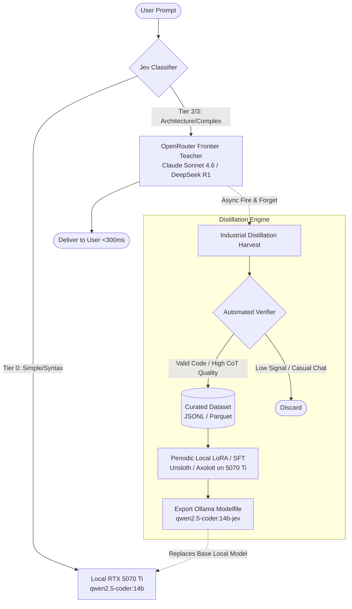

# Architecture Blueprint: Industrial Distillation Pipeline for Jev Gateway

> **Status:** Conceptual / Planned Feature  
> **Target Project:** [jev-gateway](file:///home/jpi/Projects/jev-gateway)  
> **Hardware Target:** Local NVIDIA RTX 5070 Ti (16GB VRAM) + OpenRouter Cloud

---

## 1. Vision & Core Philosophy

Currently, **Jev Gateway** functions as a deterministic, cost-aware router between local models ($0 GPU) and frontier models (OpenRouter Claude/Gemini). 

Every time a complex prompt is routed to a Tier 2/Tier 3 cloud model, money is spent, a superior response is received, and that intelligence is immediately discarded from the system's memory.

**The Distillation Pipeline turns Jev into a closed-loop self-improving flywheel:**
> Every dollar spent on OpenRouter acts as an investment that trains the local 5070 Ti model to replace the cloud model on future similar tasks.



---

## 2. Key Architectural Components

### A. The Harvester (Zero-Latency Async Interceptor)
- Placed in `server.py` and `main.py` response handler.
- When `tier >= 2` (Cloud), spawn an asynchronous background worker before streaming/returning the result.
- **Harvest Payload:**
  - `prompt`: Original user instruction + RAG context injected from Obsidian PKM.
  - `system_prompt`: Jev task framing.
  - `reasoning_trace`: Chain-of-thought (captured from models like DeepSeek R1 or Claude Thinking).
  - `completion`: Final solution/code.
  - `metadata`: Token count, model used, timestamp, latency, task classification tag.

### B. The Quality Verifier (Industrial Filter)
Not all traces are worth distilling. The pipeline rejects noise:
1. **Code Execution / Syntax Linter:** Run code blocks through `tree-sitter` or `python -m py_compile` / `cargo check` to ensure syntax is 100% valid.
2. **Signal-to-Noise Heuristic:** Exclude trivial greetings, one-line clarifications, or queries with no structural complexity.
3. **De-duplication:** Semantic deduplication against previously harvested samples using local `nomic-embed-text` embeddings.

### C. Dataset Vault & Storage
- Stored under: `~/.config/jev/distill/`
- Formats:
  - `raw_traces.jsonl`: Unprocessed captured stream.
  - `training_golden.jsonl`: Filtered, verified Alpaca/ShareGPT formatted pairs ready for fine-tuning.

### D. The Trainer (Local GPU Adaptation)
- **Engine:** [Unsloth](https://github.com/unslothai/unsloth) or LoRA fine-tuning scripts tailored for 16GB VRAM on the RTX 5070 Ti.
- **Base Student Model:** `Qwen2.5-Coder-14B-Instruct` or `Llama-3.1-8B-Instruct`.
- **Target:** Produces a specialized GGUF quantized model (`qwen2.5-coder:14b-jev-custom`) imported directly into Ollama.

---

## 3. Proposed CLI Interface for `jev`

```bash
# Check distillation dataset statistics
jev distill status
# -> Collected: 1,420 samples | Verified Golden: 890 | Ready for training

# Inspect recent captured traces
jev distill list --limit 10

# Export dataset in Hugging Face / Axolotl / Unsloth format
jev distill export --format alpaca -o ./distill_train.jsonl

# Trigger local fine-tuning run (or launch training container)
jev distill train --base qwen2.5-coder:14b --epochs 3
```

---

## 4. Why This Architecture Wins
1. **Zero Privacy Leakage:** The final trained model lives 100% on your local machine (`jordansdesktop`).
2. **Economic Flywheel:** Your OpenRouter API budget actively drives your cloud dependency down over time.
3. **Hyper-Personalized Knowledge:** The student model learns your specific coding style, dotfiles, shell aliases, and Obsidian graph conventions.
