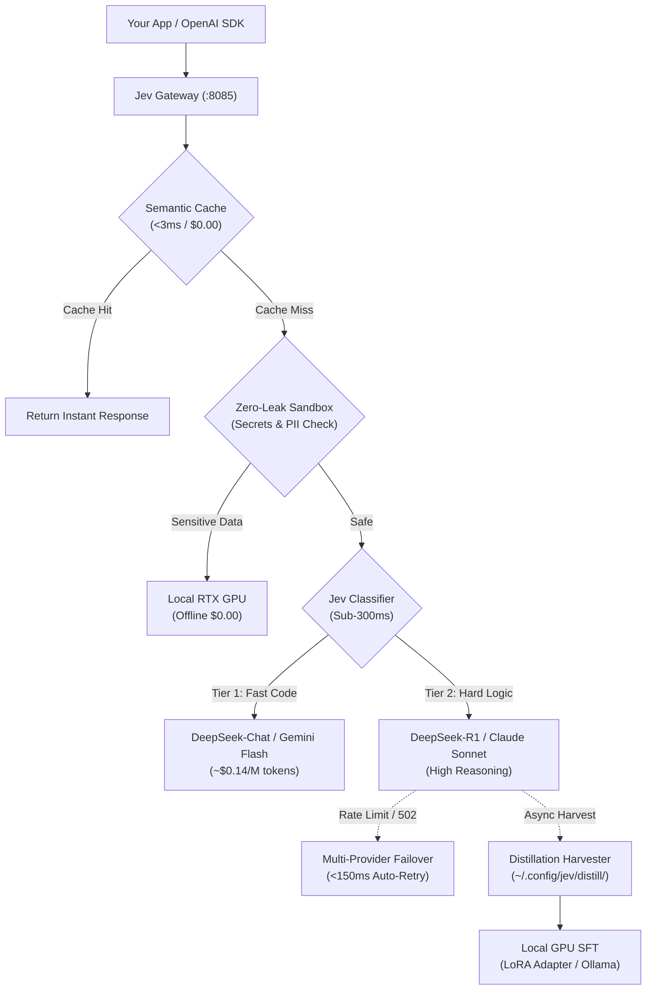

# ⚡ Jev Gateway: Enterprise Inference Optimization & Distillation Engine

[](LICENSE)
[](https://platform.openai.com/docs/api-reference)
[](#zero-leak-privacy-sandbox)
[](#multi-provider-failover)

> **Cut your AI API bills by 70–85%, guarantee 99.99% uptime with instant provider failover, and turn cloud API spend into a fine-tuned private model you own forever.**

---

## 🚀 The Problem Jev Solves

1. **Massive Cloud API Bills**: Startups burn thousands every month sending routine, repetitive queries to $15/M token frontier models.
2. **Provider Downtime & 429 Rate Limits**: Claude or OpenAI rate limits bring customer-facing applications to a halt.
3. **Zero Proprietary Moat**: Rented intelligence gives your business no defensible intellectual property.

---

## 🏗️ Architecture & Features



* ⚡ **FastPath Semantic Cache**: Delivers identical and semantically equivalent responses in `<3ms` for **$0.00**.
* 🛡️ **Zero-Leak Privacy Sandbox**: Automatically detects API keys, `.env` variables, and private credentials, forcing execution locally so secrets never leave your server.
* 🔄 **Multi-Provider Auto-Failover**: Automatically retries across fallback providers (`deepseek_chat` -> `gemini_flash` -> `local_gpu`) in `<150ms` upon timeouts or 429 errors.
* 🧪 **Automated Self-Healing Code Gate**: Syntactically validates code blocks via Python AST before delivery; auto-retries higher tiers on syntax failures.
* 🧠 **Industrial Distillation Engine**: Asynchronously harvests high-value reasoning traces into verified Alpaca/ShareGPT datasets and trains local models (`jev distill train`).

---

## ⚡ 60-Second Quickstart

### 1. Run with Docker Compose
```bash
git clone https://github.com/dragpk247/jev-gateway.git
cd jev-gateway
docker compose up -d
```

### 2. Connect Your Code (1-Line Drop-In)
Replace your existing OpenAI SDK configuration:

```python
from openai import OpenAI

# Drop-in replacement: point base_url to Jev Gateway
client = OpenAI(
    base_url="http://localhost:8085/v1",
    api_key="your-openrouter-or-jev-key"
)

response = client.chat.completions.create(
    model="auto", # or "deepseek_reasoner", "deepseek_chat", "local_gpu"
    messages=[{"role": "user", "content": "Explain quicksort average case vs worst case"}]
)

print(response.choices[0].message.content)
```

---

## 📊 Live Web Telemetry Dashboard

Visit `http://localhost:8085/dashboard` in your browser to monitor:
- **Net Dollar Savings ($)** vs. direct frontier cloud API usage.
- **FastPath Semantic Cache Hit Ratio**.
- **Privacy Interceptions Prevented**.
- **Verified Golden Distillation Samples Accumulated**.

---

## 🛠️ CLI Driver (`jev`)

```bash
# Server Management
jev start              # Launch background proxy daemon
jev status             # Check health and endpoint connectivity
jev dashboard          # Open browser telemetry dashboard

# Distillation Pipeline
jev distill status     # Inspect harvested traces and golden dataset counts
jev distill filter     # Run automated AST validation and deduplication
jev distill export     # Export training dataset in Alpaca or ShareGPT format
jev distill train      # Generate and launch local LoRA fine-tuning run
```

---

## 📜 License
MIT License. Built for high-throughput, cost-optimized, and self-improving AI workflows.
